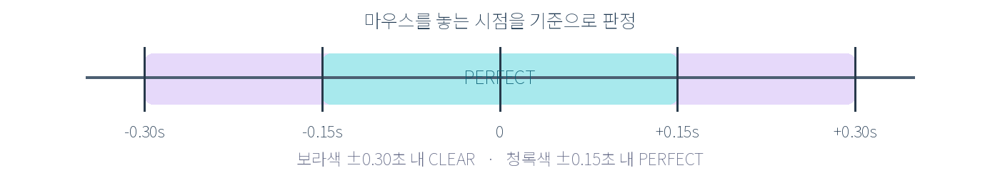
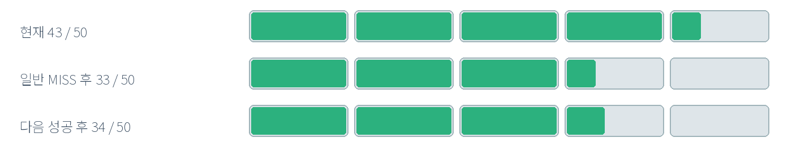
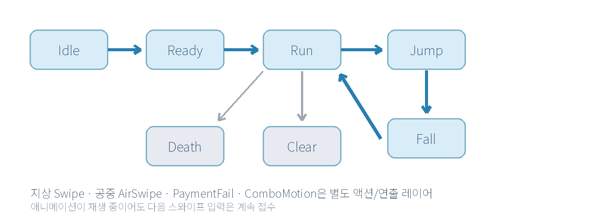
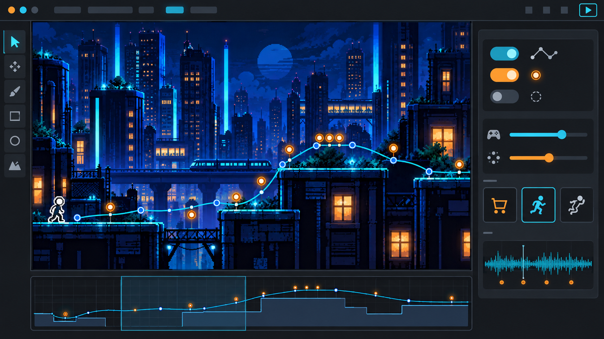
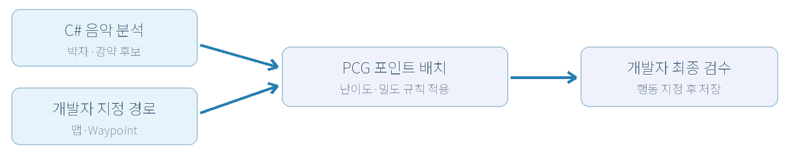
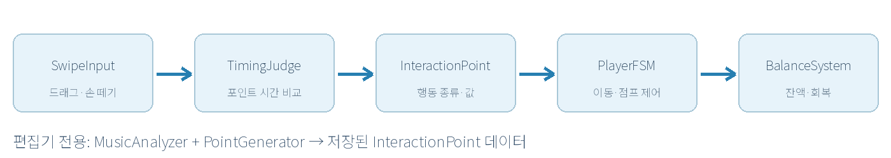
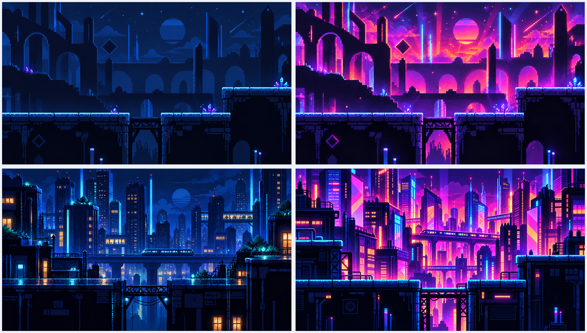
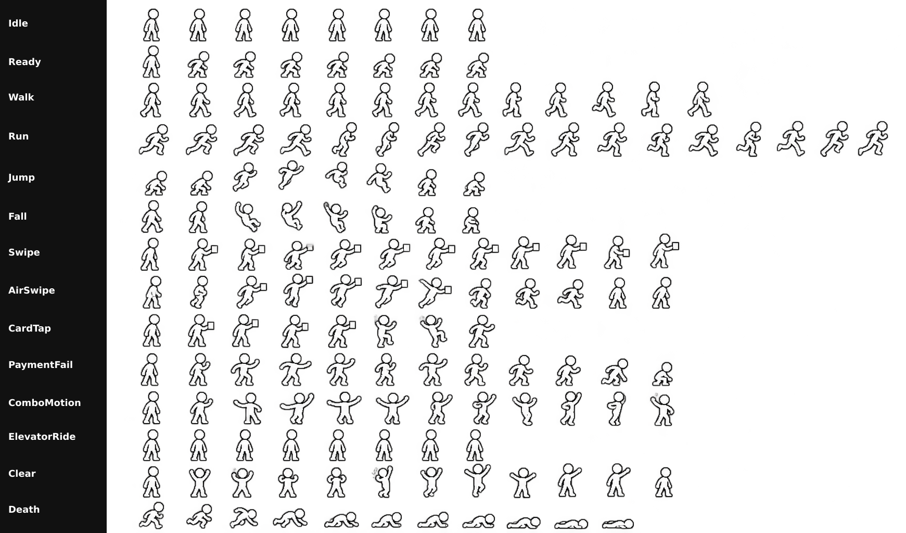

<!-- 이 문서는 SWIPE! 게임 기획서 Word 최종본에서 변환한 GitHub 제출용 문서입니다. -->

# SWIPE! 게임 기획서

AI 게임 개발  |  중간 프로젝트 기획안

*그림 1  SWIPE! 배경 콘셉트 시안  ·  생성형 AI 활용 이미지*

### 프로젝트 정보

| 항목 | 내용 |
| --- | --- |
| 과목 / 담당 | AI 게임 개발  /  안찬제 교수님 |
| 제작자 | 이연지  /  20243542  /  개인 개발 |
| 장르 / 플랫폼 | 2D 횡스크롤 리듬 액션  /  PC |
| 개발 엔진 | Unity  /  정확한 버전은 프로젝트 생성 시 확정 |
| 개발 목표 | 튜토리얼 1개 + 본편 3개  /  총 5~10분 플레이 |

한 줄 소개  |  음악과 타이밍에 맞춰 카드를 ‘촥’ 긁으며 상품을 결제하고 지형을 돌파하는 자동 진행형 리듬 액션 게임.

## 1  게임 소개와 콘셉트

SWIPE!는 플레이어가 이동 방향을 조작하는 대신, 정확한 순간에 마우스를 스와이프해 무대에서 일어날 사건을 완성하는 게임이다. 캐릭터는 화면 왼쪽에서 오른쪽으로 자동 이동하고 카메라는 이를 따라간다. 화면의 원형 타이밍 신호와 음악이 다음 행동을 예고한다.

핵심 재미는 신용카드에 한정되지 않는 다양한 카드 디자인을 긁는 행위의 손맛이다. 상품을 구매할 때마다 강한 선형 이펙트와 결제 완료 연출이 나타나며, 이를 반복해 플레이어가 결제 행동을 대리 경험하도록 설계한다.

| 레퍼런스 | SWIPE!에 반영할 특징 |
| --- | --- |
| Mad Rat Dead | 자동 진행과 음악에 밀착된 행동, 실패와 재시도의 긴장감 |
| Geometry Dash | 지형을 미리 읽고 정확한 순간에 반응하는 횡스크롤 구조 |
| 리듬 천국 시리즈 | 단순한 조작으로 만들어지는 리듬 패턴과 코믹한 피드백 |

*그림 2  음식·신발·가방 등 결제 대상과 카드 디자인 예시  ·  AI 제작 참고 시안*

대상 플레이어: 복잡한 키 조합보다 직관적인 입력, 짧은 스테이지, 반복 도전을 선호하는 캐주얼 플레이어. 카드별 시각적 개성을 추가하되 기본 입력 규칙은 유지한다.

## 2  핵심 게임플레이 루프

스테이지를 시작하면 캐릭터가 자동으로 달린다. 캐릭터와 개발자가 지정한 상호작용 포인트가 가까워질수록 원형 이펙트가 좁혀지고, 플레이어는 화면 어느 곳에서든 마우스를 드래그한 뒤 손을 뗀다. 입력 종료 시각이 포인트의 기준 시각과 얼마나 가까운지로 PERFECT, CLEAR, MISS를 결정한다.

*그림 3  모든 스테이지에서 유지되는 핵심 입력 및 행동 흐름*

### 2.1  입력 및 타이밍 규칙

| 항목 | 설정값 / 규칙 |
| --- | --- |
| 자동 전진 | 초당 5 Unity 단위, 왼쪽 → 오른쪽, 카메라 추적 |
| 스와이프 | 화면 임의 위치에서 임의 방향으로 드래그; 최소 40 px |
| 판정 기준 | 마우스 버튼을 놓은 시점과 포인트 지정 시각의 차이 |
| PERFECT | 기준 시각 ±0.15초 이내 |
| CLEAR | ±0.15초 초과 ~ ±0.30초 이내 |
| MISS | ±0.30초 범위 밖 또는 유효 입력 누락 |

*그림 4  입력 종료 시점을 기준으로 한 타이밍 판정 창*

### 2.2  포인트별 행동

포인트의 종류와 행동 파라미터는 개발자가 미리 지정한다. 플레이어의 스와이프 방향·길이로 점프 종류를 선택하지 않는다. 상품 포인트는 연결된 하나 이상의 품목에 결제 도장을 표시하고, 점프 포인트는 지정한 높이와 속도로 이동을 실행한다. 공중에서도 별도의 AirSwipe 모션과 함께 다음 포인트를 처리할 수 있다.

## 2  핵심 게임플레이와 승패 조건

### 2.3  잔액과 회복

게임 UI에서는 체력을 ‘잔액(체력)’으로 표현한다. 기본 잔액은 50이며, 10단위로 구획된 다섯 칸의 현금형 녹색 게이지로 표시한다. 한 칸 안의 1단위 변화도 채움 비율로 대략 확인할 수 있다. 일반 결제 MISS는 10 감소, PERFECT와 CLEAR는 동일하게 회복을 제공한다.

*그림 5  MISS 시 세부 회복량은 보존된다  ·  예시 43 → 33 → 34*

| 상황 | 잔액 / 성공 연속 처리 |
| --- | --- |
| 일반 상품 MISS | 잔액 -10, 누적 회복량 유지, 연속 성공 횟수 0으로 초기화 |
| PERFECT 또는 CLEAR | 잔액 +1; 연속 성공 10회까지 누적 |
| 연속 성공 10회 달성 후 | 이후 이어지는 성공마다 잔액 +2; MISS가 나면 다시 +1 |
| 잔액 0 이하 | GAME OVER; 재도전은 스테이지 시작 지점부터 |
| 낭떠러지 등 치명적 실패 | 잔액과 무관하게 즉시 GAME OVER |
| 특수 착지 성공/실패 | 전체 기획에 포함; 성공하면 +10, 실패 시 회복 없이 진행 |

### 2.4  성공·실패와 점수

마지막 지점에 도착하면 스테이지를 완료한다. 모든 상호작용에서 PERFECT를 달성했다면 ‘PERFECT CLEAR’, 그 외의 완주에는 ‘CLEAR’를 표시한다. PERFECT와 CLEAR의 게임 내 행동 결과는 같지만, 모션·연출·점수·최종 기록에 차이가 있다.

최종 점수 = PERFECT 횟수 × 100 + CLEAR 횟수 × 50 + 종료 시 남은 잔액 × 10. 게임 오버 시에는 진행률(스테이지 전체 거리 대비 도달 거리)을 백분율로 표시하고 ‘결제 한도 초과!’ 등의 문구와 함께 다시 시작·메인 메뉴·설정 버튼을 제공한다.

## 3  범위 선언과 레벨 구성

기말 평가까지의 상한은 10분 이내로 설정한다. 튜토리얼 1개와 본편 3개를 각각 1~2분으로 구성하면 총 4~8분이며, 수업 일정 안에 동작하는 핵심 시스템을 검증하기 적합하다.

| 구분 | 구현 범위 |
| --- | --- |
| MUST  필수 | 자동 진행·카메라 추적, 스와이프 판정, 결제, 기본/높은 점프, 공중 스와이프, 잔액, 게임 오버·결과 화면, FSM, C# 음악 분석, 편집기 PCG, 4개 스테이지 |
| SHOULD  여유 시 | 완성도 높은 카드/상품 이펙트, 추가 캐릭터 애니메이션, 스테이지별 배경 변화 및 코믹한 짧은 이벤트 |
| COULD  후속 | 특수 착지와 회복, 엘리베이터 연출·음악 일시정지, 일부 카드 전용 모션, 상세 스와이프 감도 설정 |
| OUT  제외 | 런타임 무작위 맵 생성, 플레이어가 스와이프 방향으로 점프 종류를 결정하는 방식, 온라인 멀티플레이 |

### 3.1  스테이지별 의도

| 구간 | 길이 | 주요 내용 |
| --- | --- | --- |
| 튜토리얼 | 약 1분 | 자동 달리기·첫 결제·타이밍 원·기본 점프를 순서대로 안내 |
| 본편 1  쉬움 | 1~2분 | 여유로운 포인트 간격, 기본 점프와 상품 결제 중심 |
| 본편 2  보통 | 1~2분 | 높은 점프, 지상·공중 교차 포인트, 불규칙 간격 도입 |
| 본편 3  어려움 | 1~2분 | 짧은 간격의 연속 포인트와 쉬는 구간의 대비, 고난도 음악 |

### 3.2  컷 우선순위

일정이 부족하면 추가 모션과 배경 연출 → 선택적 장치 → PCG 부가 기능 순서로 축소한다. 타이밍 판정과 완주 가능한 스테이지는 마지막까지 유지하며, 변경 사유는 GitHub에 기록한다.

## 4  AI 설계  FSM과 PCG

### 4.1  FSM  캐릭터 상태 관리

첫 번째 AI 기법은 FSM(Finite State Machine, 유한 상태 머신)이다. 이동 상태와 애니메이션 표현을 분리하여 점프 중에도 결제 입력을 받을 수 있도록 한다. 점프는 개발자가 포인트에 기록한 설정값으로 실행되며, 공중 스와이프는 물리 이동을 끊지 않고 전용 연출만 겹쳐 재생한다.

*그림 6  이동 상태 FSM과 별도 액션 모션 레이어의 관계*

| 현재 상태 | 전이 조건 | 다음 상태 / 실행 결과 |
| --- | --- | --- |
| Idle | 스테이지 시작 / 지정 이벤트 | Ready  ·  준비 자세 재생 |
| Ready | 준비 모션 종료 | Run  ·  자동 이동 시작 |
| Run | 점프 포인트 성공 | Jump  ·  지정된 점프 파라미터 적용 |
| Jump | 상승 종료 | Fall  ·  하강 시작 |
| Fall | 지면 접촉 | Run  ·  달리기 복귀 |
| Run / Jump / Fall | 치명적 충돌 또는 잔액 0 | Death  ·  사망 모션 후 게임 오버 |
| Run | 마지막 지점 통과 | Clear  ·  결과 화면 표시 |

모션 연출 정책: Swipe와 AirSwipe는 각각 별도 애니메이션을 사용한다. 결제 MISS에는 PaymentFail을 재생하고, 10단위 잔액 회복 시 콤보 모션은 현재 연속 입력과 스와이프 연출이 끝난 뒤 예약 재생한다. 애니메이션 재생 중에도 입력 처리는 중단하지 않는다.

## 4  AI 설계  PCG 생성 과정

### 4.2  음악 분석과 상호작용 포인트 생성

두 번째 AI 기법은 PCG(절차적 콘텐츠 생성)이다. 지형과 실제 이동 경로는 개발자가 수동으로 만든다. 여러 개의 점을 연결한 Waypoint 경로를 편집기에 표시한 뒤, C#으로 분석한 음악의 박자·강약·구간 전환 후보를 참고하여 상호작용 포인트의 위치만 자동 배치한다. 생성 결과는 개발자가 확인하고 각 포인트에 결제·점프·공중 입력 등의 행동을 직접 지정한다.

*그림 7  Unity 편집기에서의 예상 작업 화면  ·  생성형 AI 시안이며 실제 구현 화면은 아님*

*그림 8  음원 입력부터 포인트 배치와 개발자 최종 검수까지의 흐름*

### 4.3  생성 규칙과 검증

처음에는 Unity C# 내부 분석만 구현한다. 음원 샘플에서 에너지 변화·박자 후보·강한 시작점(onset)을 추출하며, 정확도가 부족할 때만 외부 AI 모델 연동을 검토한다. 포인트는 일정 간격으로 나열하지 않고, 난이도에 따라 조밀한 연속 구간과 여유 구간을 교차 생성한다.

편집기 옵션: 쉬움·보통·어려움 프리셋, 포인트 밀도, 최소 시간 간격, 연속 구간 빈도, 강약 민감도. 지나치게 겹치거나 도달 불가능한 포인트는 경고 표시 후 직접 이동·삭제한다. 이 수치들의 구체적인 기본값은 프로토타입 테스트로 확정한다.

## 5  생성형 AI 활용과 검증 계획

생성형 AI는 문서·코드·그래픽·음악·효과음의 제작 도구로 활용한다. 반면 게임 플레이 판단에 쓰이는 FSM과 PCG는 Unity에서 구현하는 규칙 기반 시스템이다. 두 종류의 AI 활용을 구분해 기록한다.

| 담당 작업 | 도구 | 활용 방식과 사람의 검수 |
| --- | --- | --- |
| 기획·문서 | ChatGPT(Codex) | 기획안 정리, 표와 도식 초안, 모순 검토; 최종 결정 직접 수정 |
| 프로그래밍 | ChatGPT(Codex) | C# 코드 초안·오류 원인 후보; 실제 Unity에서 직접 테스트 |
| 캐릭터·카드·배경 | ChatGPT 이미지 생성 | 64×64 기본 형태/참고 이미지와 새 디자인을 함께 입력; 일관성·픽셀 정렬 보정 |
| 배경 음악 | Suno AI | 스테이지별 장르·고조 구간 후보 생성 후 직접 선별·편집 |
| 효과음·보조 음원 | ElevenLabs / SellBuyMusic | 효과음은 AI 생성 후 직접 보정; 추가 음원이 필요할 때만 출처·조건 검토 |

### 5.1  대표 프롬프트 작성 방향

기획·코드 예시  |  “자 우선 유니티에 넣은 음악의 강약이랑 박자를 C#으로 분석하고 싶어. 맵은 내가 만들 테니까, 찍어 둔 경로에 포인트만 배치하는 방법을 정리해줘.”

그래픽 예시  |  “이 64×64 하얀 캐릭터가 기본 틀이야. 다른 디자인을 입혀도 비율은 유지하고 싶어. 원본이랑 참고 이미지를 같이 보고 변형해줘.”

사운드 예시  |  “처음엔 조용한데 뒤로 갈수록 신나졌으면 좋겠어. 난이도가 올라가는 느낌으로 음악 후보를 만들어줘.”

### 5.2  검토 및 AI 오류 기록

대표 프롬프트와 실제 구현에 영향을 준 오류만 GitHub의 docs/design/ai_usage_log.md에 기록한다. 기록 항목은 날짜, 사용 도구, 요청 목적, 입력 프롬프트, 결과물, 오류 또는 한계, 수정 과정, 최종 채택 여부다. 단순 아이디어 제안과 구현 검증을 구분해 남긴다.

예상 오류 및 대응: BPM 추정 오차 → 음악 시각 수동 보정, 점프 불가능한 포인트 → 에디터 경고 후 위치 수정, 캐릭터 비율·프레임 흔들림 → 64×64 기준 템플릿과 대조한다.

## 6  기술 구성과 협업 기록

Unity 2D와 C#으로 구현한다. Unity의 정확한 버전은 프로젝트 생성 시 LTS 계열에서 선택해 GitHub README 및 기획서에 기록한다. 런타임 처리와 편집기 전용 분석·생성을 분리하여, 스테이지 실행 시에는 검수된 포인트 데이터만 읽도록 한다.

*그림 9  플레이 중 주요 시스템과 편집기 전용 도구의 역할 분리*

| 모듈 / 데이터 | 주요 책임 |
| --- | --- |
| SwipeInput / TimingJudge | 드래그 길이와 릴리스 시각 계산, 타이밍 범위 판정 |
| InteractionPoint | 포인트 시간, 행동 종류, 점프 값, 연결 상품 저장 |
| PlayerFSM / AutoRunner | 자동 이동, 점프·하강·사망 상태 관리 |
| BalanceSystem / StageManager | 잔액·연속 성공·점수·진행률·완료/실패 처리 |
| MusicAnalyzer / PointGenerator | 에디터에서 음원 분석, 경로 기반 포인트 생성·검수 |

### 6.1  GitHub와 에셋 관리

저장소는 main 브랜치를 중심으로 관리하고 필요할 때만 feature/기능명 브랜치를 사용한다. 기획서는 docs/design/game_design.md, AI 사용 기록은 docs/design/ai_usage_log.md로 관리한다. 제출 후 변경 사항은 Issue 또는 PR과 커밋 메시지에 이유를 기록한다.

픽셀 그래픽 규약은 캐릭터 기준 64×64 px, 지형 기본 타일 32×32 px, 목표 화면 1920×1080이다. 현재 확보한 외부 에셋은 없으며 우선 AI 생성물과 자체 수정으로 제작한다. 필요 시 외부 음원·이미지를 추가하되 출처·라이선스·사용 범위를 기록하고 검증한다.

### 7  개인 개발 역할 분담

기획·프로그래밍·레벨 설계·그래픽 보정·오디오 편집·QA·GitHub 기록을 작성자 1인이 담당한다. AI는 초안과 후보를 생성하는 도구이며, 결과를 선택·검토·수정하고 최종적으로 설명하는 책임은 작성자에게 있다.

## 8  개발 일정과 위험 관리

개인 개발 기준 주 15시간 이상을 확보하는 계획이며, 8~15주차에 단계별로 완성한다. 일정은 핵심 입력 → 음악 분석·PCG → 스테이지 제작 → 최종 검증 순으로 구성한다.

| 주차 | 주요 작업 | 완료 기준 |
| --- | --- | --- |
| 8주차 | 기획서·범위·수치 확정 | 기획 기준선과 AI 사용 범위 문서화 |
| 9주차 | Unity 프로젝트·GitHub 생성, 자동 달리기·카메라·스와이프 입력 | 화면에서 이동·입력 확인 |
| 10주차 | 타이밍 판정, 기본·높은 점프, 결제, 잔액·실패 처리 | 음악 없이도 핵심 루프 1회 완주 |
| 11주차 | 캐릭터 FSM과 C# 음악 분석 | 상태 전이와 박자 후보 데이터 확인 |
| 12주차 | Waypoint 편집, PCG 배치·난이도 조절·경고 | 포인트 자동 생성 후 수동 수정 가능 |
| 13주차 | 튜토리얼 + 본편 1, 주요 아트·음악 1차 적용 | 기본 2개 구간 플레이 가능 |
| 14주차 | 본편 2·3 제작, 난이도별 포인트 다듬기 | 전체 4개 스테이지 연결 |
| 15주차 | 버그 수정, 싱크·밸런스·성능·제출 점검 | 10분 이내 체험 및 결과 제출 가능 |

### 8.1  위험 요소와 플랜 B

| 위험 | 대응 / 축소 계획 |
| --- | --- |
| 음악 분석의 정확도 부족 | 원형 타이밍과 포인트 시각을 에디터에서 수동 보정; 외부 ML 연동은 후순위 |
| PCG 결과의 지형 부적합 | 점프 불가능·중첩 포인트 경고, 경로 데이터 보정, 후보 수를 줄여 재생성 |
| 1인 개발 리소스 부족 | 애니메이션 프레임·배경 변형·특수 착지를 먼저 축소하고 핵심 판정 유지 |
| AI 결과물 일관성/권리 문제 | 캐릭터 템플릿 대조, 생성물 직접 수정, 서비스 약관·음원 사용 조건 확인 |
| 버전·문서 협업 기록 누락 | 주차별 커밋과 중요한 AI 오류만 기록, 기획 변경 사유를 Issue에 남김 |

## 부록 A  배경 분위기 참고 시안

스테이지 초반은 짙은 남색과 단순한 형태로 시작하며, 음악이 고조될수록 마젠타·시안·오렌지 등의 채도를 높인다. 화면의 화려함은 음악과 함께 변하지만, 상호작용 원·캐릭터·위험 지형은 항상 배경보다 선명하게 유지한다.

*그림 10  정적인 분위기·화려한 분위기·도시형 변형의 배경 참고 이미지  ·  모두 생성형 AI 시안*

### 게임에 적용할 그래픽 원칙

- 캐릭터 외곽선은 배경보다 높은 명암 대비로 유지하고, 카드 스와이프 이펙트를 입력 순간의 우선 시각 정보로 둔다.
- 상품은 음식·의류·신발 등 결제 가능한 품목으로 구성하되, 지형 장애물과 명확히 구분한다.
- 음악 변화에 따라 배경 효과와 광원을 늘리되 포인트의 원형 타이밍 표시가 묻히지 않도록 제한한다.
- 모든 이미지 시안은 실제 게임에 넣기 전 픽셀 그리드·크기·색상·프레임 기준점을 직접 수정한다.

### 레퍼런스 출처

Mad Rat Dead: [NIS America 공식 페이지](https://www.nisamerica.com/games/mad-rat-dead)

Geometry Dash: [Steam 공식 판매 페이지](https://store.steampowered.com/app/322170/)

리듬 천국 시리즈: [Nintendo 개발자 인터뷰](https://iwataasks.nintendo.com/interviews/wii/rhythmheavenfever/0/0/)

## 부록 B  캐릭터 애니메이션 참고 시트

아래 이미지는 64×64 픽셀 기본 캐릭터의 애니메이션 방향을 정리하기 위한 참고 시트다. 움직임에 따라 8·12·16프레임으로 구성할 계획이며, 실제 사용 시에는 프레임 정렬과 투명 배경, 반복 구간을 별도로 보정한다.

*그림 11  Idle, Ready, Walk, Run, Jump, Fall, Swipe, AirSwipe, CardTap, PaymentFail, ComboMotion, ElevatorRide, Clear, Death  ·  AI 제작 참고 시트*

### 생성형 AI 활용 사실 및 작성 책임

본 기획서의 게임 콘셉트, 조작 규칙, 주요 수치 및 개발 범위에 관한 핵심 아이디어와 최종 의사결정은 작성자가 직접 구상하고 선택하였다. 생성형 AI는 작성자가 제공한 내용을 바탕으로 문장을 정리하고 구조화하는 후처리, 기술 구현 방향 검토, 표·도식 및 참고 이미지 제작, 프로그램 코드 초안 제안 등에 보조적으로 활용하였다. AI가 제안한 내용과 생성 결과는 작성자가 확인하여 채택 또는 수정하며, 최종 문서와 구현에 대한 책임은 작성자에게 있다.

현재 사용: ChatGPT(Codex), ChatGPT 이미지 생성  |  향후 활용 예정: Suno AI, ElevenLabs  |  필요 시 검토: SellBuyMusic
